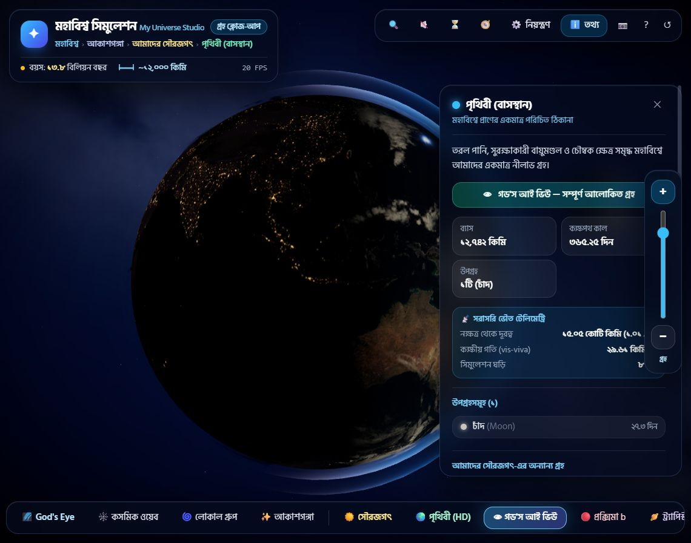
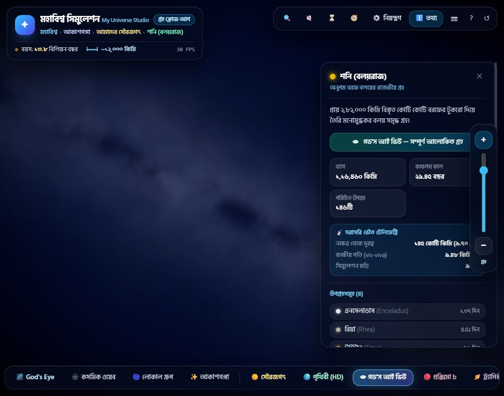
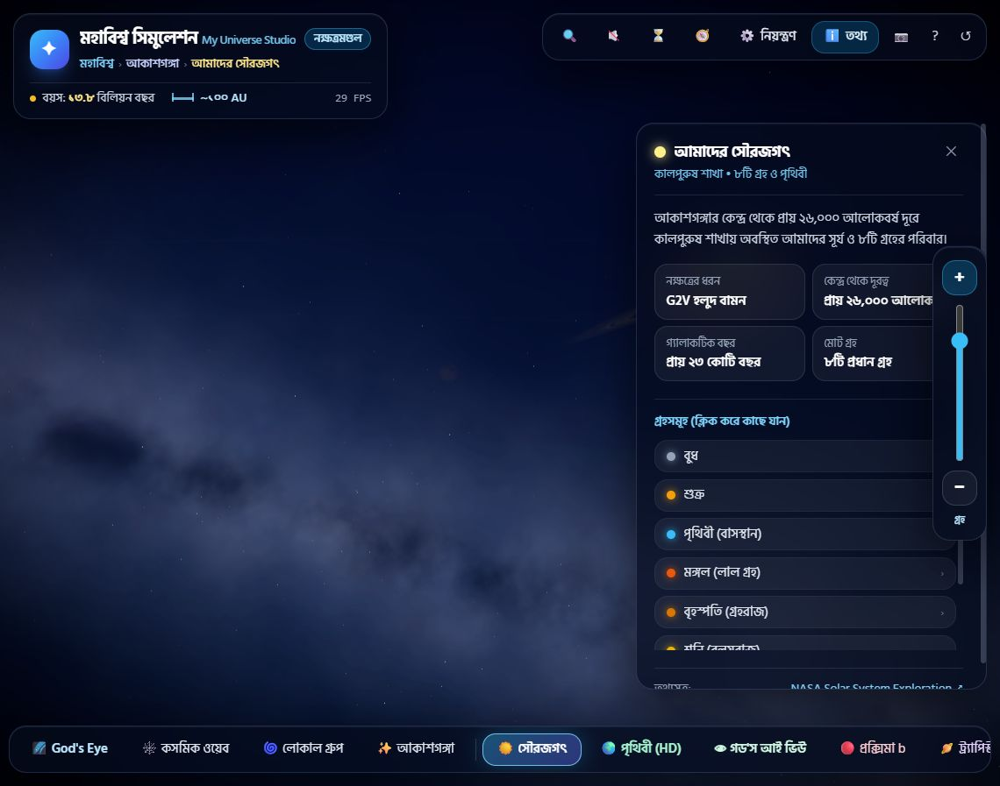
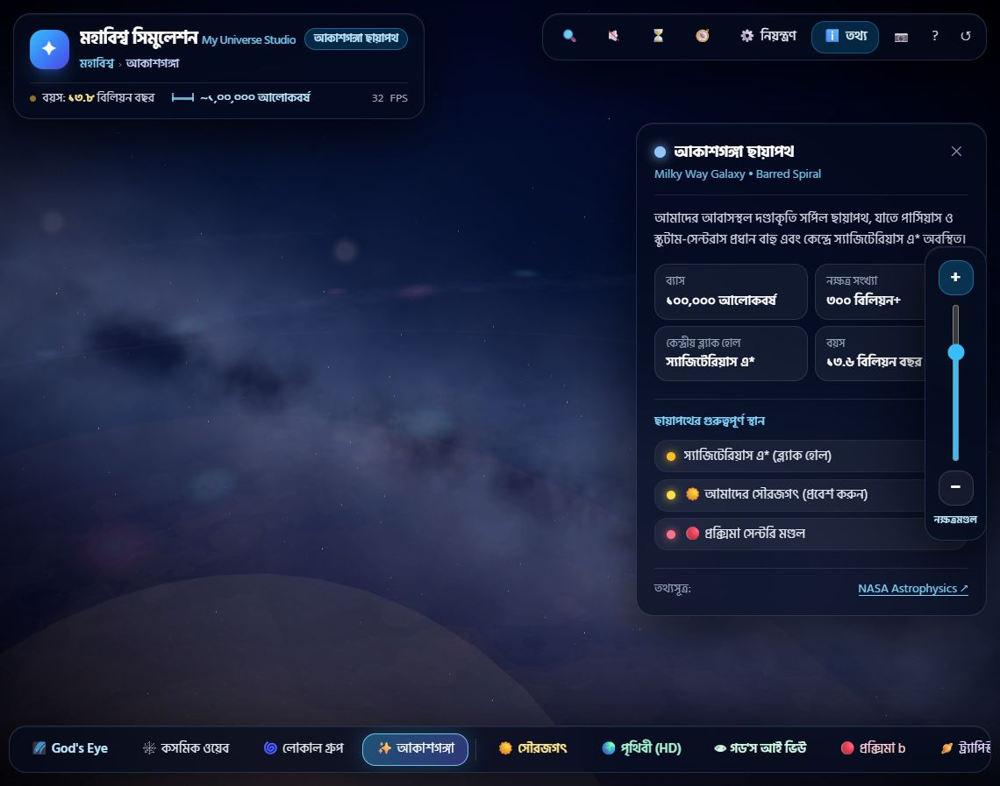

# 🌌 মহাবিশ্ব (Mahabishwo) — My Universe Studio

পর্যবেক্ষণযোগ্য মহাবিশ্ব থেকে গ্রহের পৃষ্ঠ পর্যন্ত **একটানা জুম করা যায়** এমন বাস্তবভিত্তিক, **পদার্থবিদ্যা-সঠিক** ইন্টার‌্যাক্টিভ ৩ডি মহাবিশ্ব সিমুলেশন।

মাউস হুইল ঘোরালেই ক্যামেরা ৯৩ বিলিয়ন আলোকবর্ষের মহাবিশ্ব থেকে কসমিক ওয়েব, লোকাল গ্রুপ, আকাশগঙ্গা, সৌরজগৎ হয়ে পৃথিবীর পৃষ্ঠ পর্যন্ত একটানা উড়ে যায় — কোনো লোডিং বা স্কেল-জাম্প ছাড়াই। কার্সর যেখানে রাখবেন, জুম সেদিকেই যাবে।

**An interactive, physics-accurate 3D universe simulation with seamless continuous zoom — from the observable universe down to a planet's surface.**

| গড'স আই ভিউ — সম্পূর্ণ আলোকিত পৃথিবী | শনির বলয় ও উপগ্রহ |
|:---:|:---:|
|  |  |

| সৌরজগৎ (Kepler কক্ষপথ) | আকাশগঙ্গা |
|:---:|:---:|
|  |  |

## 🔬 বাস্তব পদার্থবিদ্যা (Real Physics)

সময়ের **একক ভৌত ঘড়ি** (১ সেকেন্ড = ১ পৃথিবী-দিন, ১× গতিতে) থেকে প্রতিটি গতি নির্মিত — তাই সব অনুপাত হুবহু বাস্তব:

- **Kepler কক্ষপথ** — প্রকৃত উৎকেন্দ্রিকতায় উপবৃত্ত (বুধ e=0.206), `M = E − e·sinE` সমাধানে perihelion-এ গতি বাড়ে, aphelion-এ কমে (বুধ: **৫৮.৯৮ → ৩৮.৮৬ কিমি/সে**)
- **প্রকৃত কক্ষীয় পিরিয়ড** — NASA-র ডেটায় সঠিক অনুপাত: বুধ ৮৮ দিন, পৃথিবী ৩৬৫.২৫, নেপচুন ৬০,১৯০ দিন
- **আহ্নিক ঘূর্ণন** — প্রকৃত পিরিয়ডে: শুক্রের দিন (২৪৩) তার বছর (২২৫ দিন) অপেক্ষা দীর্ঘ, বৃহস্পতি পৃথিবীর ২.৪× দ্রুত, বুধের ৩:২ spin-orbit resonance
- **অক্ষ-কাত ও ঋতু** — ঘূর্ণন-অক্ষ মহাশূন্যে স্থির থাকে যখন গ্রহ কক্ষপথে ঘোরে (পৃথিবী ২৩.৪৪°)
- **উপগ্রহ-ব্যবস্থা** — ১৫টি উপগ্রহ প্রকৃত পিরিয়ডে: গ্যালিলিয়ান উপগ্রহের **Laplace resonance ১:২.০০৭:৪.০৪৪**, ফোবোস মঙ্গলের ঘূর্ণনকে ছাড়িয়ে যায়, ট্রাইটন **পশ্চাৎগামী**, সবাই জোয়ার-আবদ্ধ
- **গ্রহিবালুকাবেষ্টনী** — ৩টি Keplerian ব্যান্ড, ভেতরটা বাইরেরটাকে ছাড়িয়ে যায় (বাস্তব shear)
- **সরাসরি টেলিমেট্রি** — প্রতিটি গ্রহের নক্ষত্র থেকে তাৎক্ষণিক দূরত্ব ও **vis-viva গতি** লাইভ দেখা যায়
- **গতি-নিয়ন্ত্রণ ১×–১০,০০০×** — ১০,০০০× এ নেপচুন মাত্র ৬ সেকেন্ডে প্রদক্ষিণ করে
- সূর্যের ২৫.৩৮ দিনের Carrington ঘূর্ণন, চাঁদের ৫.১৪° কাত কক্ষপথ

## ✨ বৈশিষ্ট্য (Features)

- **একটানা লগারিদমিক জুম** — হুইল/পিঞ্চ দিয়ে যেকোনো জায়গায় (গ্যালাক্সির বাহু, গ্রহ, সুপারক্লাস্টার) জুম-টু-কার্সর
- **৭টি মহাজাগতিক স্কেল** — পর্যবেক্ষণযোগ্য মহাবিশ্ব → কসমিক ওয়েব → লোকাল গ্রুপ → আকাশগঙ্গা → নক্ষত্রমণ্ডল → গ্রহ → গ্রহপৃষ্ঠ, সব ক্রসফেড হয়ে মিশে যায়
- **👁 গড'স আই ভিউ** — পৃথিবীকে (ও অন্য যেকোনো গ্রহকে) সূর্যমুখী ক্যামেরায় একটাই সম্পূর্ণ আলোকিত ডিস্ক হিসেবে দেখুন, চারপাশে উপগ্রহ ঘুরছে
- **আসল NASA/USGS টেক্সচার** — পৃথিবীর Blue Marble + নরমাল/রাফনেস/মেঘ/রাতের সিটি-লাইট, চাঁদ ও সব গ্রহের ফটোগ্রাফিক ম্যাপ (অফলাইনে প্রসিডিউরাল ফলব্যাক)
- **HDR রেন্ডারিং** — ACES টোন ম্যাপিং, ব্লুম, ভিনিয়েট, কাস্টম GLSL শেডার (সূর্যের গ্রানুলেশন, বায়ুমণ্ডল, অ্যাক্রিশন ডিস্ক, CMB)
- **ক্লিক করে যেকোনো বস্তুতে প্রবেশ** — সুপারক্লাস্টার, গ্যালাক্সি, ব্ল্যাক হোল, সূর্য, প্রতিটি গ্রহ ও উপগ্রহ
- **৪টি নক্ষত্রমণ্ডল** — সৌরজগৎ, প্রক্সিমা সেন্টরি, TRAPPIST-1, Kepler-186
- কসমিক টাইমলাইন (বিগ ব্যাং → ১৩.৮ বিলিয়ন বছর), রাডার মিনিম্যাপ, সার্চ, ফটো মোড, অ্যাম্বিয়েন্ট সাউন্ড
- সম্পূর্ণ বাংলা UI (Hind Siliguri ফন্ট)

## 🚀 চালানো (Run Locally)

```bash
npm install
npm run dev
```

ব্রাউজারে খুলুন: http://localhost:3000

প্রোডাকশন বিল্ড:

```bash
npm run build
npm run preview
```

## 🎮 নিয়ন্ত্রণ (Controls)

| কাজ | উপায় |
|---|---|
| ঘোরান | বাম ড্র্যাগ |
| সরান (Pan) | ডান ড্র্যাগ / Shift + ড্র্যাগ |
| জুম (যেকোনো জায়গায়) | হুইল (কার্সরের দিকে) / পিঞ্চ / ডানপাশের স্লাইডার |
| বস্তুতে প্রবেশ | ক্লিক / ট্যাপ |
| গড'স আই ভিউ | নেভিগেশন বারের "👁 গড'স আই ভিউ" পিল |
| চালু-বন্ধ | `Space` |
| খুঁজুন | `/` |
| ফটো মোড | `F` |
| টাইমলাইন | `T` |
| গাইড | `H` |
| সময়ের গতি | নিয়ন্ত্রণ প্যানেল (⚙️) → ০ থেকে ১০,০০০× |

## 🛠️ প্রযুক্তি (Tech Stack)

- [Three.js](https://threejs.org/) (WebGL2) + [postprocessing](https://github.com/pmndrs/postprocessing) (HDR Bloom / ACES)
- কাস্টম GLSL শেডার ও প্রসিডিউরাল টেক্সচার জেনারেশন
- TypeScript + Vite + Tailwind CSS + GSAP

## 📚 তথ্যসূত্র (Data Sources)

NASA, ESA Planck Mission, SDSS, Cosmicflows-3 — প্রতিটি বস্তুর প্যানেলে মূল সূত্রের লিংক দেওয়া আছে। কক্ষপথ, ঘূর্ণন ও উপগ্রহ-পিরিয়ড NASA/JPL-এর প্রকাশিত মান থেকে নেওয়া।

## 📄 লাইসেন্স

[MIT](LICENSE)
